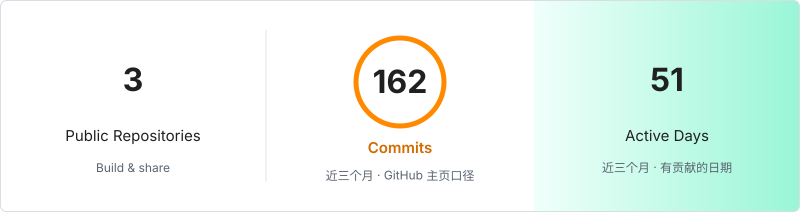
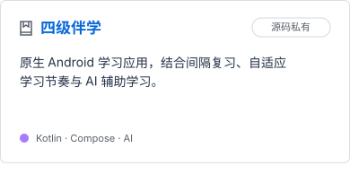
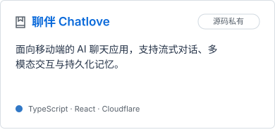

# Hi there 👋 I'm EVkkj

一名小小的个人开发者 努力做更好的项目 打磨更好的产品🤗   
Android 原生开发 · AI 功能集成 · Web 全栈实践

<p>


</p>

<picture>
<source media="(max-width: 600px)" srcset="./assets/generated/overview-mobile.svg" />

</picture>

<p>
<a href="https://github.com/ccwbb78/mimo-code-Multimodal-integration"></a>
<a href="https://github.com/ccwbb78/design-skills"></a>


</p>

## Languages & tools

<p>


</p>


<sub>代码量为数量级粗估，非精确 Git 行数统计。编码时长更新于 2026-11-01。</sub>

## What I work with

```text
Android    Kotlin · Java · Compose
Web        TypeScript · JavaScript · React
Backend    Go · Workers · D1 · R2
Workflow   Python · Git · AI tools
```

<details>
<summary>More explorations</summary>

- Android 网络客户端与设备生命周期
- Godot / C# 的 Android 平台适配学习
- Minecraft 数据包玩法与服务端扩展
- 数据可视化与 Web 交互体验

</details>

<sub>GitHub 统计区间：2025-11-02 — 2026-11-01。仅展示聚合数据。</sub>
